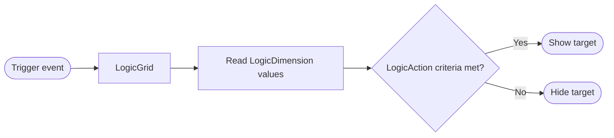
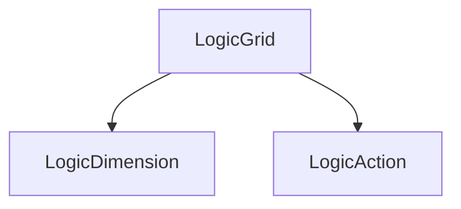
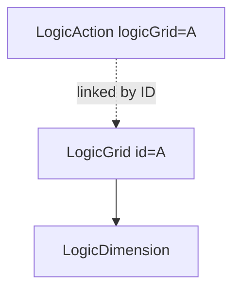
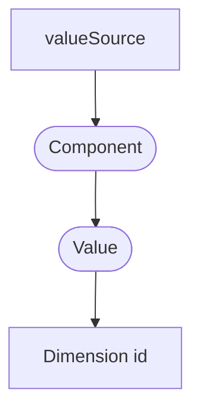
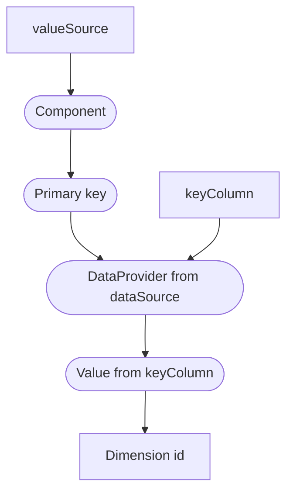
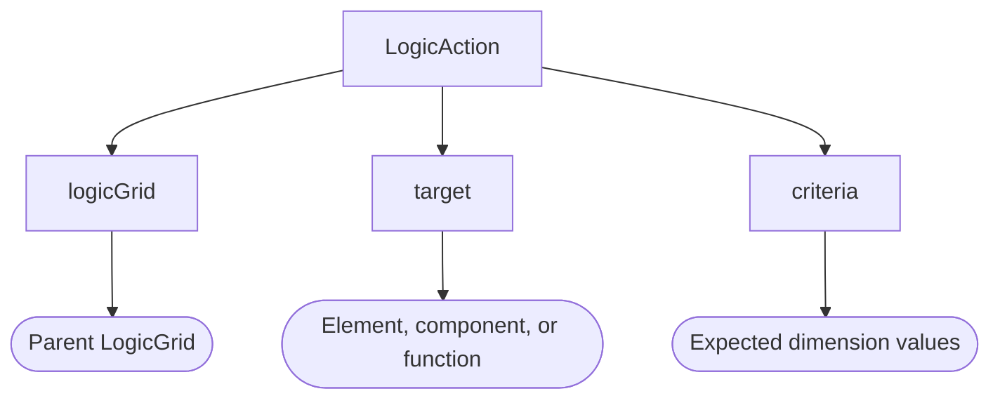

# Logic Grid

SilkBuilder's LogicGrid components control when HTML elements, SilkBuilder components, or functions appear or disappear based on criteria you define. There are three components:

| Component | Role |
|---|---|
| **LogicGrid** | The container. Listens for events and runs the logic evaluation. |
| **LogicDimension** | A named variable whose value is read from a component during evaluation. |
| **LogicAction** | Links a target to a set of criteria. The target is shown when the criteria are met and hidden otherwise. |

## How it works

1. An event listed in the LogicGrid's `trigger` fires (for example, a select list changes).
2. The LogicGrid reads the current value of each of its LogicDimensions.
3. Each LogicAction compares those values against its criteria.
4. If all criteria match, the action's target is shown; if any criterion fails, the target is hidden.



## LogicGrid

The LogicGrid component creates a logic unit that contains the LogicDimension and LogicAction components.

The basic structure of a LogicGrid is:

```xml
<silk:LogicGrid trigger="">
    <silk:LogicDimension id="" valueSource="" />
    <silk:LogicAction target="" criteria="" />
</silk:LogicGrid>
```

Here, the LogicGrid is the parent of one LogicDimension and one LogicAction. A LogicGrid can contain as many dimensions and actions as needed.



### Properties

| Property | Required | Description |
|---|---|---|
| `trigger` | Yes | One or more `<componentID>:<event>` pairs that start the logic evaluation. |
| `id` | No | Unique identifier. Needed only when a LogicAction is declared outside the LogicGrid. |

### The trigger

The `trigger` property sets the event, or events, the LogicGrid listens to. When one of them fires, the LogicGrid runs the logic evaluation. Each trigger follows the format `<componentID>:<event>`.

The example below connects the LogicGrid to the `click` event of the `reportBt` component.

```xml
<silk:LogicGrid trigger="reportBt:click">
```

To listen to more than one event, separate them with commas. In the example below, the LogicGrid listens to a button click and a form load event.

```xml
<silk:LogicGrid trigger="reportBt:click, reportForm:load">
```

### The id

The `id` property is the LogicGrid's unique identifier. It is optional.

You only need it when a LogicAction is declared outside the LogicGrid tag. This lets you place the LogicAction next to the element or component it affects, which makes the page easier to read and maintain.

The example below declares a LogicAction outside the LogicGrid tag and links it back with the `logicGrid` property.

```xml
<silk:LogicGrid id="A" trigger="">
    <silk:LogicDimension id="" valueSource="" />
</silk:LogicGrid>

<!-- elsewhere on the page -->
<silk:LogicAction logicGrid="A" target="" criteria="" />
```

In this case, the relationship is:



## LogicDimension

The LogicDimension component defines a dimension (a named variable) and where its value is read from during logic evaluation.

### Properties

| Property | Required | Description |
|---|---|---|
| `id` | Yes | The dimension's name, used in LogicAction criteria. |
| `valueSource` | Yes | The component method that returns the dimension's value, e.g. `colorList.getValue()`. |
| `dataSource` | No | A DataProvider used to translate the returned value into a value from another column. |
| `keyColumn` | No | The column in `dataSource` to read the value from. Defaults to `keyValue`. |

### The id

The `id` property defines the dimension's name. You use this name when writing criteria.

### The valueSource

The `valueSource` property sets the component method that returns the value the dimension will use.

In the example below, the LogicDimension defines a dimension called `color`, whose value comes from the `getValue()` method of a select list called `colorList`.

```xml
<silk:LogicDimension id="color" valueSource="colorList.getValue()" />
```

The data flow is:



### The dataSource

Use `dataSource` when the value you want to test is not the primary key returned by the `valueSource` component, but another column of the same record. `dataSource` takes the name of a **DataProvider** component. The LogicGrid uses the value returned by `valueSource` to find the matching record in the DataProvider.

### The keyColumn

The `keyColumn` property specifies the column in the `dataSource` from which the dimension's value is read. If omitted, it defaults to `keyValue`.

In the example below, `colorList.getValue()` returns a record's primary key, and the dimension `color` takes the value of that record's `colorKey` column in the `colorDP` DataProvider.

```xml
<silk:LogicDimension id="color" valueSource="colorList.getValue()"
    dataSource="colorDP" keyColumn="colorKey"
/>
```

This makes criteria easier to write and read: `color:red` is much clearer than `color:1`.

The data flow is:



## LogicAction

The LogicAction links a target to the criteria that decide whether it is shown or hidden.

### Properties

| Property | Required | Description |
|---|---|---|
| `target` | Yes | The HTML element, SilkComponent, or function affected by the evaluation. |
| `criteria` | Yes* | The conditions the dimensions must meet. *Can be written in the tag body instead. |
| `logicGrid` | No | The ID of the parent LogicGrid. Needed only when the LogicAction is outside the LogicGrid. |

### The target

The `target` property sets what is affected by the logic evaluation. It can be:

- **HTML element** — the element must have an `id`, referenced with a hash symbol. Example: `target="#colorBox"`.
- **SilkComponent** — the component's name. The component must have a `toggle` method. Example: `target="reportBt"`.
- **Function** — the name of a function that receives a boolean parameter indicating whether the criteria were met. Example: `target="myFunction"`.

### The criteria

The criteria define the dimension values required for the target to be visible. They can be set in the `criteria` property or in the LogicAction tag body.

Each criterion follows the format `<dimension-name>:<expected-value>`.

#### Simple criteria

In the example below, the `colorBox` DIV is visible when the `color` dimension equals `green`.

```xml
<silk:LogicAction target="#colorBox" criteria="color:green" />
```

#### Multiple criteria (AND)

When the LogicGrid has several dimensions, separate the criteria with commas. The example below uses two dimensions, `color` and `plant`.

```xml
<silk:LogicAction target="#colorBox" criteria="color:green, plant:tree" />
```

Criteria are combined with AND: every criterion must match. If any one fails, the target is hidden.

#### OR logic

OR logic is available only between values of the same dimension, not between different dimensions. Use the pipe symbol `|` to list the accepted values. The example below accepts `green` or `blue` for the `color` dimension.

```xml
<silk:LogicAction target="#colorBox" criteria="color:green|blue, plant:tree" />
```

This reads as: *(color is green OR blue) AND plant is tree*.

#### Criteria in the body

Criteria can also be written in the tag body, one criterion per line. This is easier to read when you track many dimensions.

```xml
<silk:LogicAction target="#colorBox">
    color:green|blue
    plant:tree
    region:desert
</silk:LogicAction>
```

### The logicGrid

The `logicGrid` property is needed only when the LogicAction is declared outside the LogicGrid container. It takes the LogicGrid's `id`.

```xml
<silk:LogicAction logicGrid="colorLG" target="#colorBox" criteria="color:green" />
```

The relationship is:



## Sample applications

> **Tip:** The logic is evaluated only when a trigger fires. Add the `silk-hidden` class to targets that should start hidden, so they don't appear before the user makes a selection.

### Sample 1: One dimension

Selecting an option shows the green box, the red box, or neither.

```xml
<%@ taglib uri="/WEB-INF/silk.tld" prefix="silk" %>
<%@ page contentType="text/html;charset=UTF-8" %>
<silk:App title="">

    <div class="container">
        <div id="box1" class="text-white bg-success p-4 silk-hidden">
            Green
        </div>
        <div id="box2" class="text-white bg-danger p-4 silk-hidden">
            Red
        </div>
        <div class="py-2">
            <silk:Input id="colorList" type="select" dataSource="colorDP" mode="true" valueColumn="value" />
        </div>
    </div>

    <silk:DataProvider id="colorDP">
        0: Green Box
        1: No Box
        2: Red Box
    </silk:DataProvider>

    <silk:LogicGrid trigger="colorList:change">
        <silk:LogicDimension id="colorValue" valueSource="colorList.getValue()" />
        <silk:LogicAction target="#box1" criteria="colorValue:0" />
        <silk:LogicAction target="#box2" criteria="colorValue:2" />
    </silk:LogicGrid>

</silk:App>
```

### Sample 2: Two dimensions (AND)

Each box appears only when both select lists match: Green + Tree shows the first box, Red + Heart shows the second.

```xml
<%@ taglib uri="/WEB-INF/silk.tld" prefix="silk" %>
<%@ page contentType="text/html;charset=UTF-8" %>
<silk:App title="">

    <div class="container">
        <div id="box1" class="text-white bg-success p-4 silk-hidden">
            Green Tree
        </div>
        <div id="box2" class="text-white bg-danger p-4 silk-hidden">
            Red Heart
        </div>
        <div class="py-2">
            <silk:Input id="colorList" type="select" dataSource="colorDP" mode="true" valueColumn="value" />
            <silk:Input id="textList" type="select" dataSource="textDP" mode="true" valueColumn="value" />
        </div>
    </div>

    <silk:DataProvider id="colorDP">
        1: Green
        2: None
        3: Red
    </silk:DataProvider>

    <silk:DataProvider id="textDP">
        A: Tree
        B: None
        C: Heart
    </silk:DataProvider>

    <silk:LogicGrid id="boxLogic" trigger="colorList:change, textList:change">

        <silk:LogicDimension id="colorValue" valueSource="colorList.getValue()" />
        <silk:LogicDimension id="textValue" valueSource="textList.getValue()" />

        <silk:LogicAction target="#box1" criteria="colorValue:1, textValue:A" />
        <silk:LogicAction target="#box2" criteria="colorValue:3, textValue:C" />

    </silk:LogicGrid>

</silk:App>
```

### Sample 3: Readable keys with dataSource and keyColumn

The select list returns `colorID`, but the dimension uses the `keyColor` column, so the criteria can use readable keys (`gr`, `rd`). This sample also shows criteria written in the tag body.

```xml
<%@ taglib uri="/WEB-INF/silk.tld" prefix="silk" %>
<%@ page contentType="text/html;charset=UTF-8" %>
<silk:App title="">

    <div class="container">
        <div id="box1" class="text-white bg-success p-4 silk-hidden">
            Green
        </div>
        <div id="box2" class="text-white bg-danger p-4 silk-hidden">
            Red
        </div>
        <div class="py-2">
            <silk:Input id="colorList" type="select" dataSource="colorDP" mode="true"
                valueColumn="colorID" labelColumn="colorLabel"
            />
        </div>
    </div>

    <silk:DataProvider id="colorDP" pkColumn="colorID">
        {"colorID":1, "colorLabel":"Green", "keyColor":"gr"},
        {"colorID":2, "colorLabel":"None", "keyColor":"no"},
        {"colorID":3, "colorLabel":"Red", "keyColor":"rd"}
    </silk:DataProvider>

    <silk:LogicGrid trigger="colorList:change">

        <silk:LogicDimension id="color" valueSource="colorList.getValue()"
            dataSource="colorDP" keyColumn="keyColor"
        />

        <silk:LogicAction target="#box1">
            color:gr
        </silk:LogicAction>
        <silk:LogicAction target="#box2" criteria="color:rd" />

    </silk:LogicGrid>

</silk:App>
```